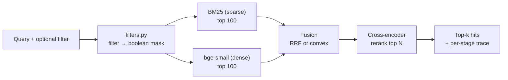

<p align="center">
  
</p>

<p align="center">
  <a href="https://github.com/iamsammy-ak/hybrid-rerank-retrieval/actions/workflows/ci.yml"></a>
  
  
  
  <a href="LICENSE"></a>
</p>

**Hybrid Rerank Retrieval** is a search stack that finds the right document when the query and the answer share
no words, and also when the query is nothing but an error code. It runs a from-scratch BM25 index and a dense
embedding index side by side, fuses their rankings, lets a cross-encoder reorder the head of the list, and
applies typed metadata filters. Every stage is timed, and a benchmark harness for BEIR datasets reports what each
stage buys in quality and costs in latency.


<sub>`python -m hybrid_retrieval demo` with the real models. The highlighted title is the document a reader
would want; the bottom row shows where each stage ranked it. Stage timings were captured on a laptop that was
short of memory at the time, so read them as relative, not absolute.</sub>

## Why this exists

Keyword search (BM25) is precise on exact terms such as product codes, acronyms and numbers, but it misses a
paraphrase: "my computer overheats" never matches "the processor runs too hot". Dense embeddings handle the
paraphrase and blur the exact term. Retrieval-augmented generation (RAG) and support search need both, plus a
reranker to put the best answer first, plus filters such as "only runbooks from 2023 onwards", all inside a
latency budget.

Each of those choices is a trade-off, and the usual advice ("just add a reranker") skips the numbers. This
repository builds every piece small enough to read, with a harness that measures how much each one adds and
what it costs.

## Features

| | |
|---|---|
| 🔤 **BM25 from scratch** | Okapi BM25 on SciPy sparse matrices with a documented tokeniser and light stemming; matches a loop-based reference implementation to 1e-5 |
| 🧭 **Dense retrieval** | `BAAI/bge-small-en-v1.5` on ONNX Runtime, query instruction prefix, exact cosine top-k, optional int8 index that is 4x smaller |
| 🔀 **Rank fusion** | Reciprocal Rank Fusion (RRF) and a convex combination with min-max or z-score normalisation |
| 🎯 **Cross-encoder rerank** | `ms-marco-MiniLM-L-6-v2` rescores the top N fused hits in batches |
| 🏷️ **Typed metadata filters** | `eq`, `in`, `range`, `and`, `or`, `not` as JSON or text (`year >= 2021 and source in [docs, runbook]`), compiled to boolean masks, applied before or after retrieval |
| 📏 **Evaluation harness** | nDCG@10, Recall@100, MRR@10 and p50/p95 latency per stage, parameter sweeps and a quality-vs-latency Pareto frontier |
| 🖥️ **CLI and HTTP API** | `hybrid-search index · search · bench · demo · serve`, plus a FastAPI `/search` endpoint on port 8702 |

## How it works



1. **Filter** (`filters.py`). A filter written as text or JSON becomes a typed expression tree, then a boolean
   mask over the corpus. With *pre-filtering* (the default) the mask is applied inside each retriever before its
   top-k is taken; with *post-filtering* non-matching hits are dropped after fusion.
2. **Sparse retrieval** (`bm25.py`). Text is normalised, split, stripped of stopwords and lightly stemmed. BM25
   weights for every (document, term) pair are precomputed into a sparse matrix whose columns are posting lists, so
   a query is one sparse matrix-vector product.
3. **Dense retrieval** (`embedders.py`, `dense.py`). The query gets the BGE instruction prefix and is embedded
   with `bge-small-en-v1.5` (384 dimensions); cosine similarity against every document is a single matrix-vector
   product, followed by an `argpartition` top-k. Exact search, no approximate index.
4. **Fusion** (`fusion.py`). RRF scores a document by `Σ 1 / (k + rank)` across the two lists. The convex
   combination normalises each list's scores (min-max or z-score) and blends them with a weight `alpha`.
5. **Rerank** (`rerank.py`). A cross-encoder reads query and passage together and rescores the first N fused
   hits; the rest keep their fused order below them, so Recall@100 stays comparable.
6. **Trace** (`search.py`). The response carries the final hits plus each stage's top hits and wall-clock time.

## Benchmarks

### BM25 on BEIR (measured)

| Dataset | Method | nDCG@10 | Recall@100 | MRR@10 | p50 ms | p95 ms | Published BM25 nDCG@10 |
|---|---|---:|---:|---:|---:|---:|---:|
| SciFact (5,183 docs, 300 queries) | BM25, light stemming | **0.677** | **0.912** | 0.647 | 0.8 | 2.7 | 0.665 |
| | BM25, no stemming | 0.665 | 0.886 | 0.632 | 0.8 | 3.7 | |
| NFCorpus (3,633 docs, 323 queries) | BM25, light stemming | **0.326** | **0.245** | 0.525 | 0.6 | 2.6 | 0.325 |
| | BM25, no stemming | 0.313 | 0.234 | 0.516 | 0.5 | 0.8 | |


What this shows:

- The from-scratch BM25 lands on the published numbers. The last column is the BM25 baseline reported in the
  BEIR paper (Thakur et al., 2021, Elasticsearch); it is cited, not measured here. Matching it is the check that
  the tokeniser, IDF and length normalisation are right.
- The light stemmer is worth about +0.012 nDCG@10 and +0.026 Recall@100 on SciFact (+0.013 and +0.011 on
  NFCorpus): conflating `increase`/`increased`/`increasing` matters on scientific text.
- BM25 is not where quality hides. Across 25 `(k1, b)` settings nDCG@10 stays within 0.667-0.684 on SciFact and
  0.319-0.330 on NFCorpus; the default (0.9, 0.4), fixed before the sweep, is within 0.007 of the best cell. The
  grid is a sensitivity check on the test split, not a tuning run.
- A query costs under a millisecond at the median (tokenise, sparse product, top-100) on 5,000 documents.

Reproduce (downloads the data on first use, needs no models, about 30 seconds per dataset):

```bash
python -m hybrid_retrieval download scifact nfcorpus
python -m hybrid_retrieval bench --dataset scifact --sparse-only
python -m hybrid_retrieval bench --dataset nfcorpus --sparse-only
python benchmarks/make_charts.py
```

Full reports with the whole grid: [`benchmarks/results/bm25_scifact.md`](benchmarks/results/bm25_scifact.md),
[`benchmarks/results/bm25_nfcorpus.md`](benchmarks/results/bm25_nfcorpus.md).

### Dense, hybrid and reranked (not yet measured)

The full comparison is implemented and tested end to end, but its SciFact run is not part of this release: on
the 8 GB laptop used for development the run was stopped for lack of memory during cross-encoder scoring, and no
number is reported that was not measured. Cross-encoder scores and their measured batch times are now
checkpointed every 25 queries under `indexes/<dataset>/bench_checkpoints/`, so an interrupted run resumes where
it stopped. One command runs it:

```bash
python -m hybrid_retrieval bench --dataset scifact      # writes benchmarks/results/scifact.{json,md}
python benchmarks/make_charts.py scifact                # Pareto frontier + per-method chart
```

It embeds the corpus once (cached under `indexes/`), then reports BM25, dense (float32 and int8, with index
memory), hybrid RRF and convex fusion (min-max and z-score), hybrid + cross-encoder at depths 10/20/30/50, BM25 +
cross-encoder, ablations (no stemming, no query instruction), sweeps of RRF `k` and convex `alpha`, a pre- vs
post-filtering experiment at 50%, 10% and 2% selectivity, per-stage p50/p95 latency, and the nDCG@10 vs p95
latency Pareto frontier. How latency is measured: stages run one query at a time in one process and are timed
with `perf_counter`; the cross-encoder scores candidates in timed batches of 10, so the latency at depth N is the
measured time of the first N/10 batches.

### Data and licences

- **SciFact**: Wadden et al., *Fact or Fiction: Verifying Scientific Claims*, EMNLP 2020. Claims and annotations
  CC BY 4.0; abstracts ODC-By 1.0 (from S2ORC).
- **NFCorpus**: Boteva et al., *A Full-Text Learning to Rank Dataset for Medical Information Retrieval*, ECIR
  2016. Free for academic use; NutritionFacts.org content is subject to its own terms.
- **BEIR** packaging: Thakur et al., *BEIR: A Heterogeneous Benchmark for Zero-shot Evaluation of Information
  Retrieval Models*, NeurIPS 2021 Datasets and Benchmarks.
- `download` fetches the official BEIR archive from UKP Lab (TU Darmstadt). When that server is unreachable (it
  was during development) it falls back to the BeIR organisation's Hugging Face mirror, pinned to a fixed
  revision and verified against SHA-256 checksums. Nothing is committed; data lives in the git-ignored `data/`.
- Hardware for the numbers above: AMD Ryzen 5 5600H (6 cores, 12 threads), 8 GB RAM, Windows 11, Python 3.13,
  one query at a time. The bundled 48-document demo corpus was written for this project.

## Quick start

```bash
git clone https://github.com/iamsammy-ak/hybrid-rerank-retrieval.git
cd hybrid-rerank-retrieval
python -m venv .venv
source .venv/bin/activate        # Windows: .venv\Scripts\activate
pip install -e ".[models,api,dev]"
python -m hybrid_retrieval demo  # uses the real models if cached, else offline stand-ins
```

The first run without a model cache downloads about 150 MB of ONNX models (`bge-small-en-v1.5` and
`ms-marco-MiniLM-L-6-v2`). `python -m hybrid_retrieval demo --offline` never downloads anything: it swaps in a
hashing embedder and a term-overlap reranker, which are clearly labelled stand-ins, not semantic models.

Search the bundled 48-document knowledge base, or index your own JSONL (`id`, `title`, `text`, `metadata`):

```bash
hybrid-search search "speed up slow database queries" --demo --rerank 20 \
    --filter 'category == "databases" and year >= 2021'
hybrid-search index --jsonl my_docs.jsonl --out indexes/my_docs --int8
hybrid-search search "how do I rotate a leaked key" --index indexes/my_docs --rerank 20 --top-k 5
hybrid-search serve --index indexes/my_docs          # http://127.0.0.1:8702/docs
```

```bash
curl -s localhost:8702/search -H 'content-type: application/json' \
  -d '{"query": "rotate a leaked key", "top_k": 3, "rerank_depth": 20, "filter": "year >= 2022"}'
```

No API key is needed: every model runs locally on the CPU. `.env.example` lists the two optional variables
(`FASTEMBED_CACHE_PATH` for the model cache, `HF_HUB_OFFLINE=1` to forbid downloads).

## Use it as a library

```python
from hybrid_retrieval import Document, HybridIndex, HybridSearcher, SearchConfig
from hybrid_retrieval.demo import load_models

docs = [
    Document(id="a", title="Rotating leaked API keys", text="Revoke the exposed key, then issue a new one.",
             metadata={"year": 2023, "team": "security"}),
    Document(id="b", title="Thermal throttling", text="A hot CPU lowers its clock speed to protect itself.",
             metadata={"year": 2020, "team": "platform"}),
    Document(id="c", title="Error E1047", text="The migration tool could not take its advisory lock.",
             metadata={"year": 2025, "team": "platform"}),
]

embedder, reranker, label = load_models(offline=False)  # real models if cached, else stand-ins
index = HybridIndex.build(docs, embedder)
searcher = HybridSearcher(index, embedder, reranker)

config = SearchConfig(mode="hybrid", fusion="rrf", rerank_depth=3, top_k=2)
response = searcher.search("my laptop overheats", config, filter='team == "platform" and year >= 2019')
for hit in response.hits:
    print(hit.rank, hit.doc_id, hit.title, round(hit.score, 3))
print({stage: round(ms, 1) for stage, ms in response.timings_ms.items()})
```

Output (the scores are raw cross-encoder logits; timings vary by machine):

```
1 b Thermal throttling -10.812
2 c Error E1047 -11.433
```

The same script is in [`examples/library_usage.py`](examples/library_usage.py). `HybridIndex.save(path)` and
`HybridIndex.load(path)` persist everything; loading refuses a query embedder that differs from the one that
built the index, because mixed embedding spaces fail silently.

## Design decisions

- **BM25 as sparse linear algebra, not a search library.** Pyserini needs a Java runtime and `rank_bm25` scores
  in Python loops. Precomputing every (document, term) BM25 weight into a CSC matrix turns a query into one
  sparse matrix-vector product that only touches the query terms' posting lists, persisted as two arrays and a
  vocabulary. Trade-off: changing `k1` or `b` re-derives the matrix (one vectorised pass), and there is no
  positional index, so no phrase queries.
- **Exact dense search instead of an approximate index.** For thousands to a few hundred thousand 384-dimension
  vectors, a brute-force matrix-vector product (about two million multiply-adds for 5,000 documents) is cheap
  and loses nothing to approximation, so there is no HNSW graph to tune. Memory is handled by the optional int8
  index instead. Past roughly a million vectors, an approximate index (HNSW or IVF) becomes the better trade.
- **RRF as the default fusion, convex combination as the tunable option.** RRF uses only ranks, so it needs no
  score calibration and its one parameter is forgiving. A convex blend can do as well or better, but only with an
  `alpha` tuned on held-out data. The benchmark's `alpha` sweep reports how sensitive it is, as a sensitivity
  analysis on the test split, not as a tuned setting.
- **Rerank the head, keep the tail.** The cross-encoder costs one transformer pass per candidate, so latency grows
  linearly with the depth N. Reordering only the first N hits and keeping the rest below them makes N a pure
  latency knob and keeps Recall@100 comparable across depths.
- **Pre-filtering by default.** Applying the mask inside each retriever before its top-k means a selective filter
  still returns a full page when enough documents match. Post-filtering is easier to bolt onto an existing
  vector store, but it throws away retrieved candidates that fail the filter, so selective filters return short
  or empty pages: in the demo, 3 hits survive post-filtering where pre-filtering returns 5. The benchmark's
  filter experiment measures the same effect at 50%, 10% and 2% selectivity.
- **Offline stand-ins rather than mocks.** A hashing embedder and a term-overlap reranker implement the same
  interfaces as the real models, so CI exercises the identical pipeline without downloading anything; tests that
  need the real models are marked and run only where the model cache exists.

## Project structure

```
hybrid-rerank-retrieval/
├── src/hybrid_retrieval/
│   ├── tokenizer.py      normalisation, stopwords, light stemmer
│   ├── bm25.py           Okapi BM25 on SciPy sparse matrices, save/load
│   ├── embedders.py      bge-small via fastembed, hashing stand-in
│   ├── dense.py          exact cosine top-k, int8 quantisation
│   ├── fusion.py         RRF and convex combination
│   ├── rerank.py         cross-encoder and term-overlap stand-in
│   ├── filters.py        filter AST, text parser, mask compiler
│   ├── index.py          persisted hybrid index (manifest + arrays)
│   ├── search.py         the staged pipeline with per-stage timing
│   ├── metrics.py        nDCG, Recall, MRR, latency percentiles
│   ├── evaluation.py     benchmark harness, sweeps, Pareto frontier
│   ├── beir.py           BEIR download (checksummed) and loading
│   ├── api.py · cli.py   FastAPI service and Typer CLI
│   └── demo.py           demo walkthrough over data/demo_corpus.jsonl
├── benchmarks/           make_charts.py, results/ (JSON + Markdown)
├── examples/             library_usage.py
├── tests/                pytest + hypothesis, real-model tests marked `models`
└── assets/               banner, demo terminal SVG, charts
```

## Testing

```bash
ruff check . && mypy && pytest -q
```

The suite runs in well under a minute without any model download. Highlights:

- BM25 is checked against a loop-based textbook implementation on Hypothesis-generated corpora, query terms,
  `k1` and `b` values.
- Top-k selection is checked against a stable full sort; RRF and convex fusion against hand-computed scores and
  invariants (output is the union of the inputs, sorted).
- Filters: every operator, precedence, error positions, and a property test that rendering any generated
  expression tree to text and parsing it back yields the same mask; `not` is always the exact complement.
- Metrics against hand-computed nDCG values and bounds; the Pareto frontier against its definition.
- The CLI (`index`, `search`, `demo`) and the FastAPI app (through `TestClient`, no server started) end to end.
- Six tests marked `models` run the real ONNX models when they are cached locally and are skipped in CI.

## Limitations

- Single process, in memory, exact search. That is the right shape up to roughly a million documents; beyond
  that it needs an approximate index, sharding and incremental updates (adding documents currently means a
  rebuild).
- The dense, hybrid and reranked SciFact numbers are not in this release (see Benchmarks); only BM25 has been
  measured on BEIR so far. The harness for the rest is implemented and tested on the bundled corpus.
- Latency was measured on a laptop CPU that was also running other work, so absolute milliseconds are noisy.
  The relative cost of the stages is the useful signal. Queries run one at a time, with no batching across
  queries and no GPU.
- SciFact and NFCorpus are small and specialised (scientific and medical). Results can change on other domains,
  and parameter grids are computed on the test split, so they show sensitivity, not tuned values.
- The filter experiment in the harness uses synthetic random metadata, because the BEIR datasets have none.
- The tokeniser and light stemmer are English-only. The cross-encoder truncates passages at 512 tokens and was
  trained on MS MARCO web passages, not scientific abstracts.

## Roadmap

- [ ] An HNSW index behind the same interface, with a recall-vs-latency comparison against exact search
- [ ] Tune fusion weights on a held-out split and report the test score once
- [ ] Incremental indexing with append-only segments and periodic merges
- [ ] A learned sparse retriever (SPLADE) as a third first-stage list

## License

[MIT](LICENSE) © 2026 Abhishek Kumar
